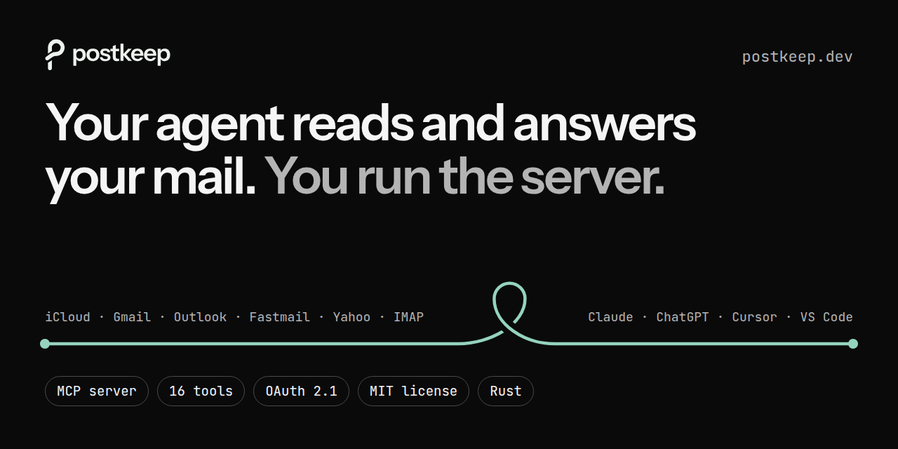

# postkeep

postkeep is a free, MIT-licensed MCP server for iCloud, Gmail, Outlook,
Fastmail, Yahoo and IMAP mail. Your agent can search, read, reply and file,
and a webhook can tell it when new mail arrives.

## Mailboxes

| Mailbox | How you connect |
| --- | --- |
| iCloud Mail | An app-specific password. The sign-in page shows the steps. |
| Gmail | An app password, or Sign in with Google. Labels show up as folders. ([setup](docs/providers/google.md)) |
| Outlook.com and Microsoft 365 | Sign in with Microsoft, with a personal or a work or school account. ([setup](docs/providers/microsoft.md)) |
| Fastmail | An app password. |
| Yahoo Mail | An app password. |
| Your own IMAP server | Added by the server's operator, with IMAP and SMTP settings. ([setup](docs/configuration.md#mail-providers)) |

For Outlook, and for Gmail with Sign in with Google, you register one OAuth
app with Microsoft or Google.
The setup guides walk you through it. Each connection is one mailbox, so add
the server to your agent app once for each mailbox you want.

## Self-host

- **Fits the machine you have.** A VPS, a home server, a container platform
  or Kubernetes. Give it HTTPS, the master key and a volume or PostgreSQL.
- **SQLite or PostgreSQL.** SQLite by default. Point it at PostgreSQL and set
  `POSTKEEP_WEBHOOKS=false` to run several replicas.
- **You hold the key.** Saved app passwords, Microsoft and Google sign-ins,
  webhook secrets and filter patterns, stored events and uploaded files, in
  your bucket, are encrypted with AES-256-GCM under data keys wrapped by a
  master key you generate.
- **You choose who connects.** List the addresses allowed to use your server
  in `POSTKEEP_ALLOWED_EMAILS`. postkeep checks it at sign-in and on every
  request.
- **An account page for each person.** At `/account` on your server, each
  person can see their connection, disconnect their agent apps, set up a
  webhook, or delete what the server keeps about them.
- **Whoever holds the key can read the saved passwords and sign-ins.**
  Connect a mailbox only to a server whose operator you trust.

The [threat model](docs/security/threat-model.md) says what the server
protects and how. To report a vulnerability privately, see
[SECURITY.md](SECURITY.md).

## Install

You need a machine with Git and Docker (with Compose), a domain name that
points at it, and ports 80 and 443 open.

```sh
# App plus Caddy, which gets the HTTPS certificate for you
git clone https://github.com/postkeep/postkeep.git
cd postkeep/deploy/compose
cp -i .env.example .env && chmod 600 .env
# Generate MASTER_KEY once, and keep a copy somewhere safe
docker run --rm postkeep/postkeep generate-key
# edit .env: PUBLIC_URL, MASTER_KEY, ALLOWED_EMAILS, DOMAIN, CLIENT_IP_HEADER
docker compose --profile caddy up -d
```

With `ALLOWED_EMAILS` empty, anyone who reaches your server can connect a
mailbox.

Back up the master key apart from the data, and keep the same key across
restarts and upgrades: it decrypts the saved passwords and sign-ins. With
another key, everyone must connect again, and webhook secrets, queued events
and filter rules are lost. To change it,
[rotate it](docs/configuration.md#rotating-the-master-key).

The `latest` image is built from `main`: read
[Upgrading](docs/deployment.md#upgrading) before you pull a newer one. Docker
without Compose, the binary with systemd, Fly.io and Kubernetes are in the
[deployment guide](docs/deployment.md), which ends with a security checklist.

## Connect your agent app

Add this address to your agent app: `https://mail.example.com/mcp`.

The app needs remote MCP with OAuth sign-in.
The [Agent apps](docs/clients.md) page has the steps for Claude,
ChatGPT, Grok, Cursor and VS Code.

When you add the address, the app opens postkeep's sign-in page. Sign in with
an app password, or with Microsoft or Google once you have set up
[their sign-in](docs/configuration.md#microsoft-and-google-sign-in). Then ask
your agent to list your folders.

Your agent reads your mail, attachments included, and text in a message can
try to steer it. Each tool is marked read-only or not, so many agent apps ask
you before anything is sent, moved or deleted: keep that on. postkeep itself
doesn't ask.

## MCP tools

| Tool | What it does |
| ---- | ------------ |
| `list_folders` | Lists your folders and their roles, such as Inbox, Sent and Trash. |
| `search_messages` | Searches a folder by sender, recipient, subject, text, date, unread or flagged, newest first. |
| `get_message` | Reads one message: headers, the body as Markdown (links and images as references, never loaded) or plain text, and the attachment list with ids; `body_format: "html"` gives the raw HTML instead (Markdown is recommended for LLMs). It stays unread. |
| `download_attachment` | Downloads one attachment of a message: images as images, text as text, other files as base64, or any file as base64 with `base64: true`, up to 3 MiB. It stays unread. |
| `send_message` | Sends a new plain-text email with any attachments or forwards a message with its attachments. Saves a copy to Sent by default. |
| `reply_to_message` | Replies, or replies to all, with any attachments, and keeps the thread together. |
| `create_draft` | Saves a new draft or threaded reply, with any attachments, to the Drafts folder without sending it. Not available for Outlook or for Gmail with Sign in with Google. |
| `update_flags` | Marks a message read or unread, flagged or unflagged. |
| `move_message` | Moves a message to another folder. |
| `delete_message` | Moves a message to the trash, or deletes it for good when you ask. |
| `create_folder` | Creates a new folder. |
| `upload_attachment` | Gives a one-time upload for one file's bytes, sent with a command, to attach to one message. Off unless the server has a bucket. |
| `get_webhook_status` | Shows whether this mailbox's new-mail webhook is active, paused, off, not set up, unreadable, waiting for a new password, or `rules_unreadable` (its filter rules can't be read or compiled), with its outbox limits and filter rule counts. |
| `set_webhook_enabled` | Turns this mailbox's new-mail webhook on or off. |
| `set_webhook_outbox_limits` | Sets how long new-mail events are kept, and how many. |
| `list_webhook_filters` | Lists this mailbox's webhook filter rules, oldest first, a page at a time. |
| `add_webhook_filter` | Adds a rule that chooses which new mail sends an event. |
| `remove_webhook_filter` | Removes one filter rule, or all of them. |

The [tool reference](docs/reference/tools.md) has each
tool's options and how providers differ.

## New-mail webhooks

Turn on a webhook for a mailbox on the account page, and postkeep sends a
small event, signed by default, to an HTTPS address you choose when mail
lands in the Inbox. Point it at something that can wake your agent. Events
carry the folder, the message id and the date, and no message body.
[New-mail webhooks](docs/webhooks.md) has the payload and how to check the
signature.

You set the webhook address and its secrets yourself, on your server's
account page. The webhook tools can't change them, so an agent that reads
untrusted mail can't redirect your webhook, though it can silence it with
filter rules ([threat model](docs/security/threat-model.md#assumptions-and-residual-risks)).

## Documentation

- [postkeep.dev/docs](https://postkeep.dev/docs/)
- [Configuration](docs/configuration.md): every setting
- [Embedding](docs/embedding.md): run the server from your own Rust binary

## Contributing

[CONTRIBUTING.md](CONTRIBUTING.md) has the checks, the integration tests and
the pull request workflow; [CHANGELOG.md](CHANGELOG.md) lists the changes.

## License

Licensed under the [MIT license](LICENSE).

Unless you explicitly state otherwise, any contribution intentionally submitted
for inclusion in the work by you shall be licensed as above, without any
additional terms or conditions.

---

postkeep is an independent project. It is not affiliated with, sponsored by or
endorsed by Anthropic, Anysphere, Apple, Docker, Fastmail, GitHub, Google,
Microsoft, OpenAI, xAI or Yahoo. Product names and logos are trademarks of
their owners.
